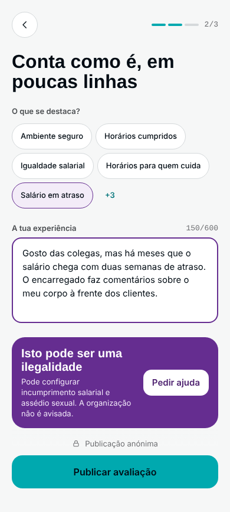

# 03 · Ecrãs e fluxos

O design completo está no **canvas** (privado): https://claude.ai/artifact/16d6Uxfp8PCM7PGgdYo6Zf — 21 ecrãs mobile e 21 desktop, ligados entre si, mais a ficha do logo animado e do ícone. As capturas abaixo são do POC (pasta [`ecras/`](ecras/)).

## Princípios
- **Uma pergunta por ecrã.** A resposta aparece no topo, grande (anel + "% para ti" + uma frase).
- **Revelação progressiva:** o secundário fica a um toque ("Ver os 8 critérios", "Ver todas", acordeões).
- **Listas magras:** anel, nome, um dado, % para ti.
- **Mobile first:** abaixo de 900 px, barra inferior com botão central "Avaliar"; a partir de 900 px, cabeçalho com navegação.
- **Dois idiomas:** português por omissão e inglês (UK), com o seletor PT · EN no cabeçalho, rodapé e Perfil. O conteúdo escrito pelas pessoas fica no idioma original.

## Página inicial (esboço do cliente, revisto a 14/10)
- **Primeiro passo:** duas zonas, cada uma um botão inteiro, só com uma palavra: **Espreitar** (em cima, branco) e **O teu trabalho** (em baixo, menta muito clara). O logo fica na fronteira e muda de cor ao atravessar a linha.
- **O primeiro clique escolhe** (telemóvel e computador): a zona clicada estende-se até ocupar a página (a linha desliza para o fundo ou para o topo) enquanto a outra se retrai; o logo sai (já está no cabeçalho) e só então aparece o conteúdo:
  - **Espreitar:** "Como é trabalhar lá dentro?", pesquisa a sério (Enter leva aos resultados) e "Ver todas as organizações" (`/explorar`).
  - **O teu trabalho:** "Conta como é. Sem dar a cara." e o botão "Avaliar onde trabalho" (`/avaliar`).
- **O que acontece ao clicar:** com rato, uma dica segue o cursor ("Espreitar organizações" / "Avaliar onde trabalho"); em ecrãs táteis o texto está fixo em cada zona ("Toca para…").
- **Voltar às duas zonas:** botão ✕, tecla Escape ou o "voltar" do browser. A zona aberta fica no endereço (`/?lado=espreitar`, `/?lado=avaliar`), por isso também se pode partilhar.
- **Atalhos:** com rato, o campo de pesquisa fica logo pronto a escrever (no telemóvel não abre o teclado sem a pessoa tocar); começar a escrever nas duas zonas abre a pesquisa com o que se escreveu.
- **Cores (14/10, "branco e menta"):** o cliente achou o verde-água a cheio pesado. O verde-água fica só na linha da fronteira, no logo e nos detalhes; os botões principais são tinta. As cores estão em variáveis no topo de `features/home/Home.module.css` (trocar de paleta não mexe na estrutura nem na animação).
- **Animação:** uma mancha de luz suave segue o cursor (verde-água em cima, roxa em baixo, a cor do respeito); os olhos do logo olham para a zona onde está o cursor; em telemóvel as manchas deslizam sozinhas. Quem prefere menos movimento vê a troca sem animação.
- **Medição:** `cta_click` com `cta=abrir_espreitar` / `abrir_avaliar` (o primeiro clique), `pesquisar`, `explorar` e `avaliar` (o segundo), sempre com `area=home`.
- **Cabeçalho:** Sobre, Ranking e Contacto. **Rodapé:** Facebook e Instagram ao centro, e por baixo as ligações secundárias e o idioma.
- **Para onde foi o resto:** o início anterior, com a lista "Para ti", passa para **Explorar** (`/explorar`), o primeiro separador da barra inferior.

## Fluxos

**Primeira visita:** Página inicial (Espreitar → Ver todas, ou O teu trabalho → Avaliar) → Preferências (3 prioridades) → A preparar (logo animado) → Explorar "Para ti".

**Descobrir:** Explorar → Pesquisa / Ranking (Para mim · Nota geral, filtros) / Tipos e setores → Organização (Avaliações · Entrevistas · Salários) → Denunciar avaliação.

**Avaliar (3 passos):** Escolher organização e local no mapa (ou adicionar nova) → Verificar (email com código ou contrato/recibo; só se guarda o "sim") → Notas (8 critérios 1–5, recomendas?) → Texto (tags + 600 caracteres, red flags, bloqueio de insultos e nomes) → Publicado (+ mensagem privada de apoio se houver red flag).

**Institucional:** Sobre (missão e princípios) · Contacto (email, organizações, redes sociais e, à parte, ajuda urgente com ACT, CITE, APAV e 112).

**Conta:** Entrar (link mágico, sem palavra-passe) · Perfil (anonimato, mensagens, o que valorizo, as minhas avaliações) · Guardadas · Apoio.

**Organizações:** Para organizações (planos Grátis / Pro, "nunca vendemos posição") → Painel (responder publicamente, pulso da semana).

## Capturas

| Ecrã | Mobile | Desktop |
|---|---|---|
| Preferências |  |  |
| A preparar |  |  |
| Página inicial |  |  |
| Página inicial (EN) |  |  |
| Explorar |  |  |
| Sobre |  |  |
| Contacto |  |  |
| Pesquisa |  |  |
| Ranking |  |  |
| Tipos e setores |  |  |
| Como calculamos |  |  |
| Organização |  |  |
| Organização (EN) |  |  |
| Entrevistas |  |  |
| Salários |  |  |
| Denunciar |  |  |
| Avaliar · escolher |  |  |
| Avaliar · verificar |  |  |
| Avaliar · notas |  |  |
| Avaliar · texto |  | (no desktop está no ecrã das notas) |
| Publicado |  |  |
| Apoio |  |  |
| Guardadas |  |  |
| Perfil |  |  |
| Entrar |  |  |
| Para organizações |  |  |
| Painel da organização |  |  |
| Página não encontrada |  |  |
